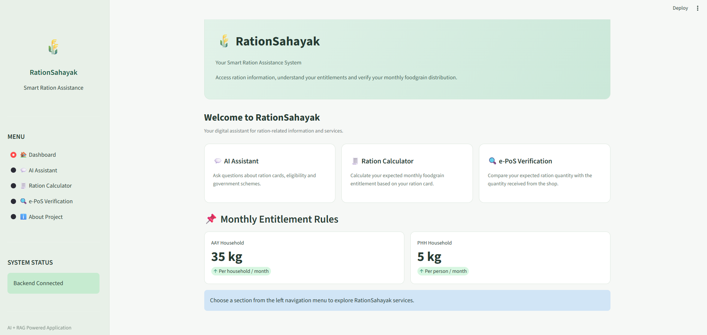

# RationSahayak


**AI-Powered Ration Assistance System for Maharashtra**

RationSahayak is an AI-powered ration assistance system designed to help users access ration-related information, understand their monthly foodgrain entitlements, and verify ration distribution.

## Day 8 – RAG Evaluation Results

Evaluated two RAG configurations using 15 test questions.

| Configuration | Chunk Size | Top-K | Total Chunks | Retrieval Accuracy | Citation Availability |
|---|---:|---:|---:|---:|---:|
| Config 1 (Winner) | 400 | 3 | 23 | 100% | 100% |
| Config 2 | 600 | 5 | 14 | 100% | 100% |

**Winner: Config 1**

Config 1 was selected because it achieved the same evaluation scores while retrieving fewer chunks per query.

*Note: Retrieval accuracy measures keyword matching in retrieved documents, not the correctness of generated answers. Citation availability measures whether source metadata was returned.*

## Day 10 – Application Improvements and Screenshots

### Application Overview

RationSahayak is an AI-powered ration assistance system designed to help users access ration-related information, understand their monthly foodgrain entitlements, and verify ration distribution.

### Key Features

1. **AI Ration Assistant**
   - Answers questions related to ration cards, eligibility and government schemes.
   - Uses Retrieval-Augmented Generation (RAG).
   - Displays source citations to support generated answers.

2. **User Feedback**
   - Allows users to mark AI responses as Helpful or Not Helpful.
   - Stores feedback in `data/feedback.csv`.
   - Records the question, answer, timestamp and feedback rating.

3. **Monthly Ration Calculator**
   - Supports AAY and PHH ration cards.
   - Calculates monthly foodgrain entitlement.
   - AAY: 35 kg per household per month.
   - PHH: 5 kg per person per month.

4. **e-PoS Verification**
   - Compares calculated entitlement with the actual quantity received.
   - Displays the difference between expected and received quantities.
   - Helps users identify possible discrepancies.

5. **Downloadable Ration Slip**
   - Generates a monthly ration slip.
   - Includes card type, family size, expected grain, received grain and quantity difference.
   - Allows users to download the slip.

### Application Screenshots

#### 1. Dashboard



#### 2. AI Chatbot


#### 3. Monthly Ration Calculator


### Feedback Collection

User feedback is stored locally in `data/feedback.csv` for future analysis and improvement of the application.

### Note

The ration calculator provides an estimated entitlement based on the selected card type and family size. The e-PoS comparison is intended for verification and is not an official confirmation of ration distribution.

## Day 11 – Testing, Code Quality and Docker Deployment

### S1 – Testing and Code Quality

Created a `tests/` directory with 14 pytest test cases.

Testing includes:

- Records loading and retrieval.
- Keyword search and search with no results.
- Record count by topic.
- FastAPI `/health` endpoint.
- FastAPI `/records` endpoint.
- FastAPI `/search` endpoint.
- FastAPI `/ask` endpoint using a fake LLM.
- AAY and PHH ration entitlement calculations.
- Invalid family size and invalid card type handling.

**Testing Results:**

- Pytest: 14 tests passed.
- Ruff: All checks passed.

### S2 – Docker Setup

Created the following Docker configuration files:

- `Dockerfile` – Defines the application image and dependencies.
- `.dockerignore` – Excludes unnecessary files and sensitive information from the Docker build context.
- `docker-compose.yml` – Runs the FastAPI backend and Streamlit frontend as separate services.

Both services communicate through Docker Compose networking.

### Run with Docker

**Prerequisites:**

- Docker Desktop installed and running.
- Docker Compose.
- Required environment variables configured in the `.env` file.

**Steps to run the application:**

1. Clone the repository:

```bash
git clone https://github.com/ruchadange1/Sanjivani-sj-14-rationsahayak.git
```

2. Navigate to the project directory:

```bash
cd Sanjivani-sj-14-rationsahayak
```

3. Create and configure the `.env` file with the required API credentials and environment variables.

4. Build and start the application:

```bash
docker compose up --build
```

### Application URLs

Once the containers are running, access the application using:

| Service | URL |
|---|---|
| Streamlit Frontend | http://localhost:8501 |
| FastAPI Backend | http://localhost:8000 |
| FastAPI Swagger Documentation | http://localhost:8000/docs |
| API Health Check | http://localhost:8000/health |

### Stop the Application

To stop and remove the running containers, execute:

```bash
docker compose down
```

## Technologies Used

- **Programming Language:** Python
- **Backend:** FastAPI
- **Frontend:** Streamlit
- **AI Architecture:** Retrieval-Augmented Generation (RAG)
- **Vector Database:** ChromaDB
- **Embeddings:** Sentence Transformers
- **Testing:** Pytest
- **Code Quality:** Ruff
- **Containerization:** Docker and Docker Compose
- **Version Control:** Git and GitHub

---

**Project:** RationSahayak – AI-Powered Ration Assistance System for Maharashtra