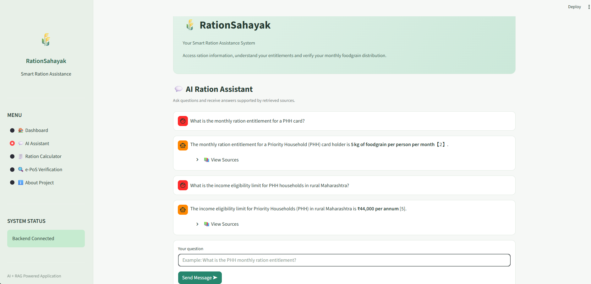
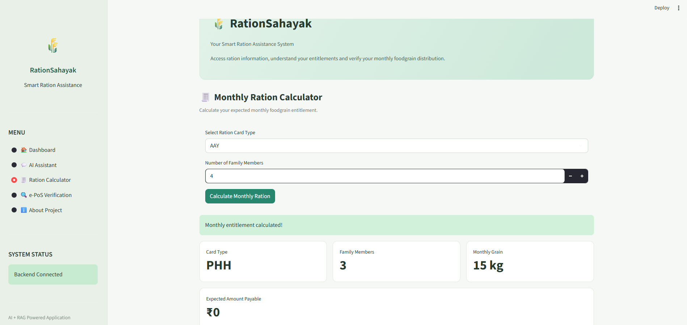

# RationSahayak

### Day 8 – RAG Evaluation Results

Evaluated two RAG configurations using 15 test questions.

| Configuration | Chunk Size | Top-K | Total Chunks | Retrieval Accuracy | Citation Availability |
|---|---:|---:|---:|---:|---:|
| Config 1 (Winner) | 400 | 3 | 23 | 100% | 100% |
| Config 2 | 600 | 5 | 14 | 100% | 100% |

**Winner: Config 1**

Config 1 was selected because it achieved the same evaluation scores while retrieving fewer chunks per query.

*Note: Retrieval accuracy measures keyword matching in retrieved documents, not the correctness of generated answers. Citation availability measures whether source metadata was returned.*

## Day 10 – Application Improvements and Screenshots

### Application Overview

RationSahayak is an AI-powered ration assistance system designed to help users access ration-related information, understand their monthly foodgrain entitlements, and verify ration distribution.

### Key Features

1. **AI Ration Assistant**
   - Answers questions related to ration cards, eligibility and government schemes.
   - Uses Retrieval-Augmented Generation (RAG).
   - Displays source citations to support generated answers.

2. **User Feedback**
   - Allows users to mark AI responses as Helpful or Not Helpful.
   - Stores feedback in `data/feedback.csv`.
   - Records the question, answer, timestamp and feedback rating.

3. **Monthly Ration Calculator**
   - Supports AAY and PHH ration cards.
   - Calculates monthly foodgrain entitlement.
   - AAY: 35 kg per household per month.
   - PHH: 5 kg per person per month.

4. **e-PoS Verification**
   - Compares calculated entitlement with the actual quantity received.
   - Displays the difference between expected and received quantities.
   - Helps users identify possible discrepancies.

5. **Downloadable Ration Slip**
   - Generates a monthly ration slip.
   - Includes card type, family size, expected grain, received grain and quantity difference.
   - Allows users to download the slip.

### Application Screenshots

#### 1. Dashboard

#### 2. AI Chatbot

#### 3. Monthly Ration Calculator

### Feedback Collection

User feedback is stored locally in `data/feedback.csv` for future analysis and improvement of the application.

### Note

The ration calculator provides an estimated entitlement based on the selected card type and family size. The e-PoS comparison is intended for verification and is not an official confirmation of ration distribution.