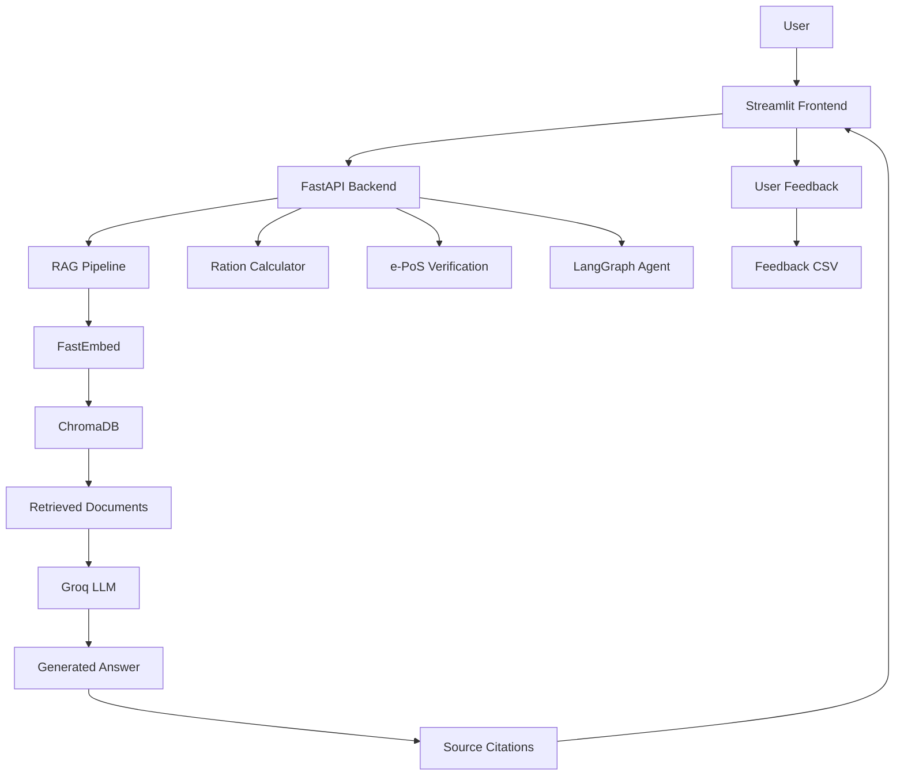

# RationSahayak 🇮🇳

### AI-Powered Ration Assistance System for Maharashtra


RationSahayak is an AI-powered ration assistance system designed to help people in Maharashtra access ration-related information, understand their monthly foodgrain entitlements, and verify ration distribution.

The application combines Retrieval-Augmented Generation (RAG), AI-powered question answering, ration entitlement calculations, and e-PoS verification to make ration-related information easier to understand and access.

---

## Live Application

| Service | URL |
|---|---|
| Streamlit Frontend | [Live Application](https://rationsahayak-ui.onrender.com) |
| FastAPI Backend | [Backend API](https://rationsahayak-api.onrender.com) |
| Swagger Documentation | [API Documentation](https://rationsahayak-api.onrender.com/docs) |
| API Health Check | [Health Check](https://rationsahayak-api.onrender.com/health) |

---

## Problem Statement

Ration card holders often face difficulties understanding government food distribution schemes, calculating their monthly foodgrain entitlements, and verifying whether they have received the correct quantity of ration.

Finding reliable information across government documents can also be challenging.

Traditional keyword searches may not understand the meaning or context behind a user's question.

## Solution

RationSahayak provides an AI-powered platform that simplifies access to ration-related information.

It combines semantic search, Retrieval-Augmented Generation (RAG), and LLM-based question answering to deliver context-based responses with source citations.

The platform also includes ration entitlement calculations, e-PoS verification, and downloadable ration slips, helping users understand and verify their monthly foodgrain distribution.

---

## Key Features

### 1. AI Ration Assistant

- Answers questions related to ration cards, eligibility, and government schemes.
- Uses Retrieval-Augmented Generation (RAG).
- Retrieves relevant information from indexed government documents.
- Generates answers using the Groq LLM API.
- Displays source citations to support generated answers.

### 2. Monthly Ration Calculator

- Supports Antyodaya Anna Yojana (AAY) and Priority Household (PHH) ration cards.
- Calculates monthly foodgrain entitlement based on card type and family size.
- AAY: 35 kg per household per month.
- PHH: 5 kg per person per month.

### 3. e-PoS Verification

- Compares calculated entitlement with the actual quantity received.
- Displays the difference between expected and received quantities.
- Helps users identify possible discrepancies.

### 4. Downloadable Ration Slip

- Generates a monthly ration slip.
- Includes card type, family size, expected grain, received grain, and quantity difference.
- Allows users to download the slip.

### 5. User Feedback

- Allows users to mark AI responses as Helpful or Not Helpful.
- Stores feedback in `data/feedback.csv`.
- Records the question, answer, timestamp, and feedback rating.

---

## System Architecture

RationSahayak follows a modular architecture combining a Streamlit frontend, FastAPI backend, RAG pipeline, vector database, and LLM integration.

### Architecture Diagram



### RAG Workflow

1. User submits a ration-related question.
2. FastAPI receives the question.
3. FastEmbed generates embeddings for semantic retrieval.
4. ChromaDB retrieves relevant document chunks.
5. Retrieved information is added to the LLM prompt.
6. Groq generates an answer using the retrieved context.
7. The application returns the answer with source citations.

---

## Application Screenshots

### 1. Dashboard


### 2. AI Chatbot


### 3. Monthly Ration Calculator


---

## RAG Evaluation Results

Evaluated two RAG configurations using 15 test questions.

| Configuration | Chunk Size | Top-K | Total Chunks | Retrieval Accuracy | Citation Availability |
|---|---:|---:|---:|---:|---:|
| Config 1 (Winner) | 400 | 3 | 23 | 100% | 100% |
| Config 2 | 600 | 5 | 14 | 100% | 100% |

**Winner: Config 1**

Config 1 was selected because it achieved the same evaluation scores while retrieving fewer chunks per query.

*Note: Retrieval accuracy measures keyword matching in retrieved documents, not the correctness of generated answers. Citation availability measures whether source metadata was returned.*

---

## Production Readiness and Performance Improvements

RationSahayak includes additional improvements focused on performance, input validation, and safer LLM interactions.

### 1. LLM Monitoring

Each LLM request logs:

- Request ID.
- LLM provider.
- Response latency.
- Input token count.
- Output token count.
- Total token count.
- Request status.

**Observed Groq Request:**

| Metric | Observed Value |
|---|---:|
| LLM Latency | 1.184 seconds |
| Input Tokens | 2,765 |
| Output Tokens | 503 |
| Total Tokens | 3,268 |
| Status | Success |

*Note: These values represent one observed request, not average or benchmark performance. Latency measures the LLM call, not the complete API request.*

### 2. Response Caching

Implemented an in-memory TTL cache using `cachetools`.

| Setting | Value |
|---|---|
| Maximum Cache Size | 100 responses |
| Cache Expiration | 10 minutes |
| Question Matching | Case-insensitive |
| Whitespace Handling | Normalized |

**Benefits:**

- Avoids repeated LLM calls for equivalent questions.
- Reduces unnecessary API requests.
- Improves response time for repeated questions.

*Note: The cache is stored in memory and is cleared when the application restarts.*

### 3. Input Validation

Implemented question-length validation using Pydantic.

- Maximum question length: 1,000 characters.
- Empty questions are rejected.
- Questions exceeding the character limit return HTTP 422.

### 4. Prompt-Injection Safeguards

Added prompt-level security instructions to strengthen RAG interactions.

- Treats user questions and retrieved documents as untrusted input.
- Prevents retrieved document instructions from overriding system instructions.
- Restricts answers to the retrieved context.
- Includes safeguards against revealing internal instructions and credentials.

*Note: Prompt-level safeguards provide an additional defensive layer but do not guarantee protection against every possible prompt-injection attack.*

### 5. Automated Testing

Added automated tests covering:

- Response caching.
- Repeated question handling.
- Input-length validation.
- Prompt-injection guardrail construction.
- API endpoints.
- Ration entitlement calculations.
- Record retrieval and search.
- LangGraph tool integration.

**Latest Testing Results:**

| Quality Check | Result |
|---|---|
| Pytest | 19 tests passed |
| Ruff | All checks passed |
| Cache Verification | Passed |
| Input Validation | Passed |
| Prompt-Injection Guardrail Test | Passed |

---

## Docker Setup

Created the following Docker configuration files:

- `Dockerfile` – Defines the application image and dependencies.
- `.dockerignore` – Excludes unnecessary files and sensitive information from the Docker build context.
- `docker-compose.yml` – Runs the FastAPI backend and Streamlit frontend as separate services.

Both services communicate through Docker Compose networking.

### Prerequisites

- Docker Desktop installed and running.
- Docker Compose.
- Required environment variables configured in the `.env` file.

### Run with Docker

**1. Clone the repository**

```bash
git clone https://github.com/ruchadange1/Sanjivani-sj-14-rationsahayak.git
```

**2. Navigate to the project directory**

```bash
cd Sanjivani-sj-14-rationsahayak
```

**3. Configure environment variables**

Create a `.env` file and configure the required API credentials and environment variables.

**4. Build and start the application**

```bash
docker compose up --build
```

### Local Application URLs

| Service | URL |
|---|---|
| Streamlit Frontend | http://localhost:8501 |
| FastAPI Backend | http://localhost:8000 |
| Swagger Documentation | http://localhost:8000/docs |
| API Health Check | http://localhost:8000/health |

### Stop the Application

```bash
docker compose down
```

---

## CI/CD – GitHub Actions

Implemented a GitHub Actions workflow for automated testing, code quality checks, and Docker build verification.

**Workflow file:** `.github/workflows/ci.yml`

### CI Pipeline

The pipeline performs:

1. Ruff code-quality checks.
2. Pytest automated testing.
3. Docker image build verification.

### CI Results

- Ruff checks: Passed.
- Pytest: 19 tests passed.
- Docker build: Successful.
- GitHub Actions: Required checks passed.

### Pull Request Workflow

- Created a feature branch for CI/CD implementation.
- Opened a pull request.
- Verified that CI checks passed.
- Merged the pull request into the `main` branch.

The GitHub Actions status badge at the top of this README displays the workflow status.

---

## Deployment – Render

Deployed RationSahayak using Render with separate frontend and backend services.

### Backend Deployment

- Platform: Render.
- Framework: FastAPI.
- Runtime: Docker.
- API health endpoint: `/health`.
- Automatic document indexing during application startup.
- Groq integration for LLM-based answer generation.

### Frontend Deployment

- Platform: Render.
- Framework: Streamlit.
- Runtime: Docker.
- Connected to the deployed FastAPI backend using the `API_URL` environment variable.

### Deployment Verification

Verified the following:

- Frontend loads successfully.
- Backend health endpoint returns a healthy response.
- RAG question answering works.
- Retrieved source citations are returned.
- Monthly ration calculator works.
- e-PoS verification identifies quantity differences.
- User feedback interaction works.

---

## Demo Video

**Project Demonstration:** Coming soon.

---

## Technologies Used

| Category | Technologies |
|---|---|
| Programming Language | Python |
| Backend | FastAPI |
| Frontend | Streamlit |
| LLM Provider | Groq |
| AI Architecture | Retrieval-Augmented Generation (RAG) |
| Agent Framework | LangGraph |
| Vector Database | ChromaDB |
| Embeddings | FastEmbed |
| Caching | Cachetools |
| Data Validation | Pydantic |
| Testing | Pytest |
| Code Quality | Ruff |
| Containerization | Docker, Docker Compose |
| CI/CD | GitHub Actions |
| Deployment | Render |
| Version Control | Git, GitHub |

---

## Future Improvements

- Expand multilingual support for Marathi and Hindi.
- Integrate additional official government ration data sources.
- Improve RAG evaluation using a larger question-answer dataset.
- Introduce persistent caching for improved scalability.
- Add user authentication and personalized ration history.
- Improve monitoring and performance under concurrent requests.

---

## Project Repository

**GitHub Repository:**

[ RationSahayak – GitHub](https://github.com/ruchadange1/Sanjivani-sj-14-rationsahayak)

**Live Application:**

[ RationSahayak – Live Application](https://rationsahayak-ui.onrender.com)

---

## Important Note

The ration calculator provides an estimated entitlement based on the selected card type and family size.

The e-PoS comparison is intended for verification purposes and is not an official confirmation of ration distribution.

---

## Author

**Rucha Dange**

GitHub: [ruchadange1](https://github.com/ruchadange1)

---

*RationSahayak – AI-Powered Ration Assistance System for Maharashtra.*