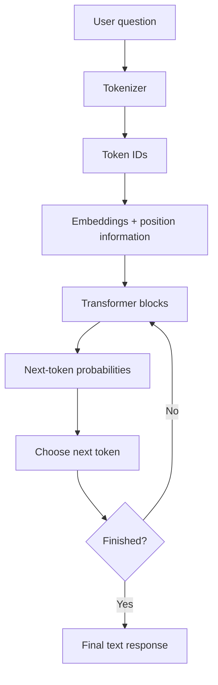

# How LLMs Work

## What is an LLM?

A Large Language Model (LLM) is an AI model trained on a large amount of text. It learns language patterns and generates text by predicting one token at a time. ChatGPT is an example of an application powered by an LLM.

## How an LLM processes a question

1. **Input:** A user types a question, for example, "How much grain does a PHH family receive?"
2. **Tokenization:** The tokenizer splits the text into small pieces called tokens. A token can be a word, part of a word, or punctuation.
3. **Token IDs:** Each token is mapped to a number from the tokenizer's vocabulary. The model works with these numbers, not directly with text.
4. **Embeddings:** The model looks up a learned vector for each token ID. These vectors help represent patterns and relationships between tokens.
5. **Positional information:** The model adds information about token order, because changing word order can change a sentence's meaning.
6. **Transformer blocks:** Attention helps each token use relevant context from other tokens. Feed-forward layers further process the representations. Multiple blocks are stacked.
7. **Next-token probabilities:** The final model output is converted into scores/probabilities for possible next tokens.
8. **Text generation:** The model selects a next token and repeats the process until it produces a complete answer or reaches a stopping limit.

## How an LLM is trained

- **Data collection and cleaning:** Gather suitable text and remove duplicates, low-quality material, and content that should not be used.
- **Pre-training:** Train the model to predict the next token in text. The model's weights are adjusted to reduce prediction error.
- **Instruction fine-tuning:** Train further on examples of instructions and good responses so the model learns to follow requests.
- **Preference alignment:** Human feedback or preference methods can help make responses more helpful and safer.
- **Evaluation:** Test knowledge, reasoning, reliability, bias, and safety before release.

## One diagram

## Important terms

- **Token:** A small text unit processed by the model.
- **Tokenizer:** Converts text into tokens and token IDs.
- **Embedding:** A learned list of numbers representing a token.
- **Attention:** Helps the model focus on relevant tokens in the current context.
- **Transformer:** The neural-network architecture used by most modern LLMs.
- **Pre-training:** The initial large-scale training stage.
- **Fine-tuning:** Additional training for a particular behaviour or task.
- **Inference:** Using a trained model to generate an answer.
- **Hallucination:** When a model produces information that sounds convincing but is unsupported or incorrect.

### Ten real RationSahayak user questions

These questions are based on the RationSahayak project card and its target user: a migrant construction worker from Beed living in Kopargaon with a family of five.

1. **AAY Entitlement:** How much grain does an AAY card get?
2. **ONORC Portability:** Can I use my Beed ration card in Kopargaon?
3. **PHH Entitlement:** What is the PHH grain entitlement?
4. **Grievance:** Where can I complain about receiving less ration?
5. **Family Entitlement:** My family has five members and a PHH card. How much grain should we receive every month?
6. **Personal Transaction (Unanswerable):** How many kilograms of rice and wheat did my family actually collect from our fair price shop last month?

   **Expected limitation:** RationSahayak cannot answer this because its dataset contains general government scheme information, not individual ration-shop transaction histories.

7. **New Ration Card:** What documents are required to apply for a new ration card in Maharashtra?
8. **Authentication:** What should I do if biometric authentication fails at the ration shop?
9. **Interstate Portability:** Can I use my Maharashtra ration card in another state under ONORC?
10. **Nutrition Benefits:** What benefits are available under NFSA for pregnant women and children?

## Scope and limitation of RationSahayak

RationSahayak currently uses collected DFPD, NFSA, and Maharashtra MahaFood information. It can answer questions only when the relevant fact is present in its records. It does not have access to an individual's ration-card account, fair-price-shop transaction history, live stock, or personal identity records. For such questions, it should clearly explain the limitation instead of guessing.
